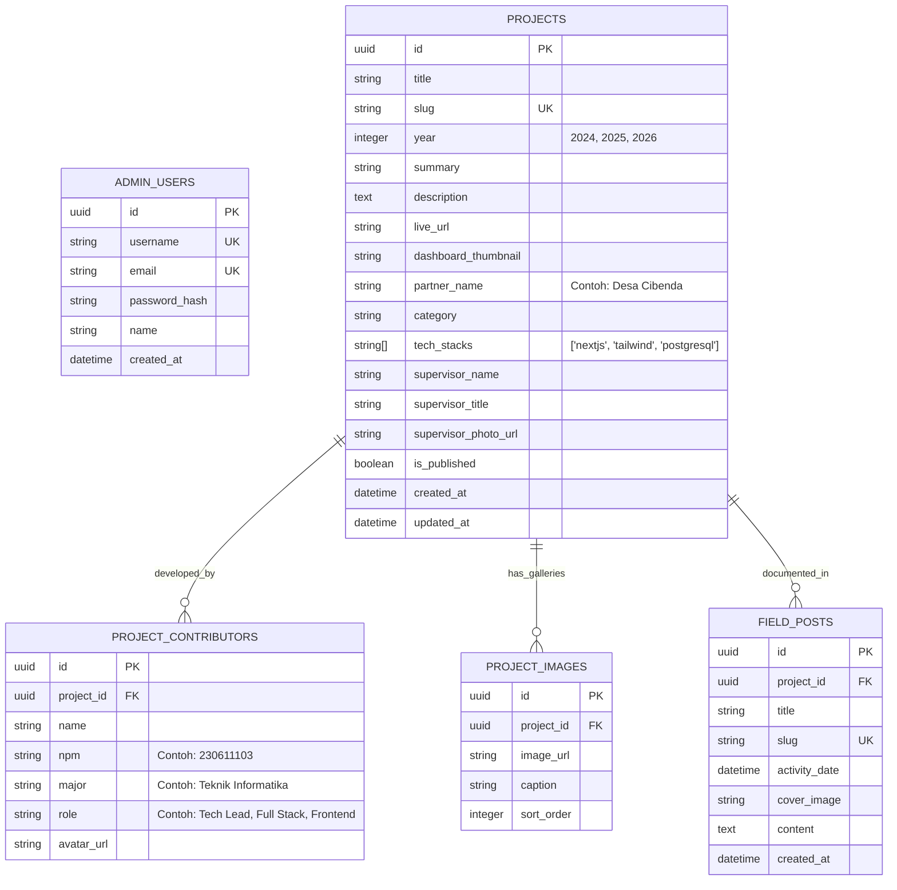

# Product Requirements Document (PRD) — Berdampak Utama (berdampak.widyatama.ac.id)

**Versi:** 1.2 (Updated: Hero Mainhall, Contributor NPM & Avatars, Tech Stack Logos, URL-only Admin CMS)  
**Status:** Approved for Development & Design  
**Author:** Naufal Fadhiil & Tim Pengembang  
**Domain Target:** `berdampak.widyatama.ac.id`  
**Institusi:** Universitas Widyatama (Bandung) × Diktisaintek Berdampak

---

## 1. Executive Summary & Visi Produk

### 1.1 Latar Belakang
Universitas Widyatama melalui program pengabdian kepada masyarakat dan dukungan **Diktisaintek Berdampak** (Kementerian Pendidikan Tinggi, Sains, dan Teknologi) secara konsisten menghasilkan berbagai aplikasi dan sistem informasi digital nyata untuk masyarakat dan desa mitra. Proyek unggulan yang telah dan sedang diimplementasikan antara lain:
- **SIGAP** (Sistem Informasi Gawat Darurat & Pengaduan Warga Desa Cibenda)
- **SIDUtama** (Sistem Informasi Desa Universitas Widyatama)
- **Sistem Informasi Desa Cibenda** (Portal layanan publik, profil desa, dan potensi UMKM)

Portal **Berdampak Utama (`berdampak.widyatama.ac.id`)** adalah platform resmi yang bertindak sebagai etalase (*portfolio showcase*) dan dokumentasi digital seluruh karya teknologi terapan sivitas akademika Universitas Widyatama.

### 1.2 Tujuan Utama (Product Goals)
1. **Showcase Portofolio Digital:** Menampilkan preview foto dashboard interaktif dari setiap proyek web yang disertai rincian tim pengembang (foto profil, nama, NPM, dan program studi).
2. **Filter Fleksibel Berdasarkan Tahun & Kategori:** Memudahkan publik dan asesor melihat rekam jejak pengerjaan proyek dari tahun ke tahun (2024, 2025, 2026).
3. **Catatan Lapangan & Blog Tim:** Menyediakan ruang dokumentasi foto dan cerita kegiatan mahasiswa dan dosen saat terjun langsung ke Desa Cibenda.
4. **Halaman Detail Akademis & Kemitraan:** Menampilkan profil dosen pembimbing, tim mahasiswa beserta perannya (Tech Lead, Full Stack, Frontend, Backend), dan logo resmi tech stack yang digunakan.
5. **Panel Admin Khusus (CMS via Direct URL):** Akses admin khusus melalui rute rahasia/langsung tanpa tombol publik di navbar, untuk menjamin keamanan dan kebersihan antarmuka.

---

## 2. Target Pengguna & Persona

| Persona / Peran | Deskripsi | Kebutuhan Utama |
| :--- | :--- | :--- |
| **Masyarakat Umum & Mitra Desa** | Warga desa binaan (Desa Cibenda), perangkat desa, dan publik | Menemukan sistem layanan desa dan melihat dokumentasi kegiatan |
| **Pimpinan Kampus & Asesor Diktisaintek** | Tim kementerian, asesor akreditasi, pimpinan universitas | Menilai luaran pengabdian masyarakat (IKU), keterlibatan mahasiswa (NPM), dan kesinambungan proyek |
| **Mahasiswa & Dosen Pengembang** | Tim perancang sistem (SIGAP, SIDUtama, dll.) | Portofolio resmi lengkap dengan nama, foto, peran, dan NPM |
| **Admin Pengelola (Humas / LPPM / IT)** | Pengelola portal Berdampak Utama | Mengelola data proyek via `/admin/login`, menginput profil kontributor dan dosen, upload foto dashboard & galeri lapangan |

---

## 3. Ruang Lingkup Proyek (Scope of Work)

### 3.1 In-Scope (Fase 1 / MVP)
- **Halaman Utama (Landing Page):**
  - Header dengan co-branding logo **Universitas Widyatama** dan **Diktisaintek Berdampak** (tanpa tombol admin).
  - Hero section berlatar belakang foto resmi gedung **Mainhall Universitas Widyatama (*L'Arc d'Academia*)** dengan overlay navy elegan.
  - Search bar terintegrasi di Hero.
  - Katalog proyek dengan **Filter Tahun Pengerjaan** (2024, 2025, 2026) dan **Filter Kategori**.
  - Kartu proyek dengan:
    - Screenshot dashboard asli (rasio 16:9).
    - Badge tahun dan nama desa mitra.
    - Judul dan deskripsi singkat.
    - **Foto profil lingkaran bertumpuk kontributor**, nama lengkap, **NPM**, dan **Jurusan** (contoh: *S1 Teknik Informatika*).
    - Tombol *"Lihat Detail Proyek"* dan *"Kunjungi Web ↗"*.
  - Section **Catatan Lapangan & Dokumentasi Tim** (foto-foto kegiatan mahasiswa/dosen di Balai Desa Cibenda).
  - Footer institusi lengkap.
- **Halaman Detail Proyek (`/projek/[slug]`):**
  - Header judul proyek dan metadata status (tanpa tombol link buka web, fokus akademis).
  - Showcase tangkapan layar dashboard aplikasi rasio 16:9.
  - Kolom konten: Latar belakang masalah, fitur kunci sistem, dan galeri foto tim di lapangan.
  - Sidebar kanan:
    - **Foto & Profil Dosen Pembimbing** (Nama, gelar, peran).
    - **Foto & Profil Tim Mahasiswa** (Foto lingkaran, nama lengkap, NPM, jurusan, dan peran spesifik: *Tech Lead, Full Stack, Frontend, Backend*).
    - **Tech Stack berupa Logo/Ikon Resmi Berwarna** (Next.js, Tailwind CSS, PostgreSQL, Node.js, dll.).
- **Halaman Login Admin (`/admin/login`):**
  - Form login terpusat dengan branding Widyatama dan Diktisaintek (diakses langsung melalui URL).
- **Halaman Admin Input/CMS Data Proyek (`/admin/projek/baru`):**
  - Form input proyek: Judul, slug, tahun pengerjaan, URL live web, thumbnail dashboard.
  - Repeater input tim mahasiswa (foto, nama, NPM, jurusan, peran).
  - Input dosen pembimbing (foto, nama, gelar, peran).
  - Pemilihan tech stack dengan checkbox berikon logo.
  - Multi-upload galeri dokumentasi lapangan dengan caption.

---

## 4. Kebutuhan Fungsional (Detailed Functional Requirements)

### Modul A: Public Showcase
- **FR-PUB-01 (Co-Branding Header):** Menampilkan logo Universitas Widyatama dan Diktisaintek Berdampak. Tombol admin **ditiadakan** dari navbar.
- **FR-PUB-02 (Hero Mainhall):** Menampilkan foto asli Mainhall Widyatama sebagai background dengan overlay gelap transparan, teks judul putih, dan input pencarian.
- **FR-PUB-03 (Filter Tahun & Kategori):** Filter tahun pengerjaan (Semua, 2026, 2025, 2024) dan filter kategori.
- **FR-PUB-04 (Kartu Proyek & Kontributor):**
  - Menampilkan screenshot dashboard 16:9.
  - Menampilkan avatar bertumpuk para kontributor mahasiswa.
  - Menampilkan teks rincian nama, nomor NPM, dan jurusan masing-masing kontributor.
  - Aksi tombol "Lihat Detail Proyek" dan "Kunjungi Web ↗".
- **FR-PUB-05 (Catatan Lapangan / Blog):** Menampilkan 3 kartu artikel dokumentasi pengerjaan tim di Desa Cibenda.

### Modul B: Halaman Detail Proyek
- **FR-DET-01 (Header Fokus Judul):** Menampilkan judul proyek dan tag status. Tombol eksternal "Buka Aplikasi Web" dihilangkan.
- **FR-DET-02 (Profil Dosen & Tim):** Menampilkan foto profil, nama, NPM, program studi, dan peran masing-masing anggota tim pengembang serta dosen pembimbing.
- **FR-DET-03 (Tech Stack Logo):** Menampilkan deretan logo/ikon resmi teknologi pendukung (Next.js, Tailwind, Postgres, dsb.) dengan label nama di bawahnya.
- **FR-DET-04 (Galeri Dokumentasi Lapangan):** Grid 4 foto dokumentasi mahasiswa di Balai Desa Cibenda.

### Modul C: Admin CMS (`/admin/projek/baru`)
- **FR-ADM-01 (Autentikasi URL):** Login admin melalui rute langsung `/admin/login` (tanpa tombol publik pada navbar).
- **FR-ADM-02 (Layout CMS Full-Width):** Antarmuka CMS bersih tanpa sidebar vertikal. Navbar atas memuat logo Widyatama, Diktisaintek, profil admin, dan tombol Logout.
- **FR-ADM-03 (Urutan Form Input Data Proyek):**
  1. *Card 1 — Informasi Umum & Filter:* Judul, slug, tahun pengerjaan (2026/2025/2024), kategori, mitra (Desa Cibenda), URL live web, toggle status publikasi.
  2. *Card 2 — Deskripsi & Dokumentasi Lapangan:* Deskripsi singkat untuk kartu beranda, deskripsi lengkap/cerita dampak (Rich Text editor), dan upload multi-foto dokumentasi lapangan di Desa Cibenda dengan caption.
  3. *Card 3 — Tangkapan Layar Dashboard Utama:* Upload drag-and-drop cover dashboard aplikasi rasio 16:9.
  4. *Card 4 — Pilihan Tech Stack:* Checkbox multi-select berikon logo resmi (Next.js, Tailwind, PostgreSQL, Node.js, dll.).
  5. *Card 5 — Tim Pengembang & Dosen Pembimbing:* Form dosen pembimbing (foto, nama, gelar, peran) dan repeater kontributor mahasiswa (foto profil, nama, nomor NPM, jurusan, peran: *Tech Lead, Full Stack, Frontend, Backend, UI/UX*).
- **FR-ADM-04 (Aksi Simpan):** Sticky bottom bar dengan tombol *"Simpan sebagai Draft"* dan *"Publikasikan Proyek Sekarang"*.

---

## 5. Desain Skema Database (Updated Schema)

---

## 6. Rekomendasi Tech Stack untuk Rekan Developer
- **Framework:** Next.js 14/15 (App Router, TypeScript)
- **Styling:** Tailwind CSS + shadcn/ui
- **Icons & Tech Logos:** Lucide React + Simple Icons (untuk logo resmi Next.js, Tailwind, PostgreSQL, Node.js)
- **Database:** PostgreSQL (Supabase / Neon) dengan Prisma ORM
- **Media Storage:** Supabase Storage / Cloudinary (foto profil mahasiswa/dosen, screenshot dashboard, dan galeri kegiatan)
- **Deployment:** Vercel (koneksi ke subdomain `berdampak.widyatama.ac.id`)
